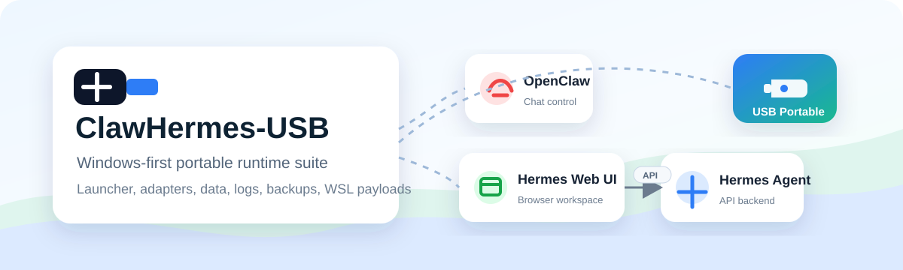
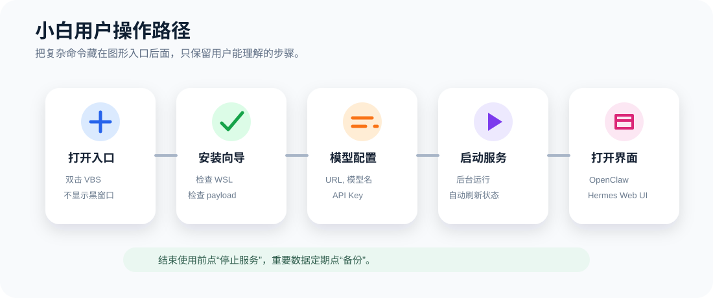
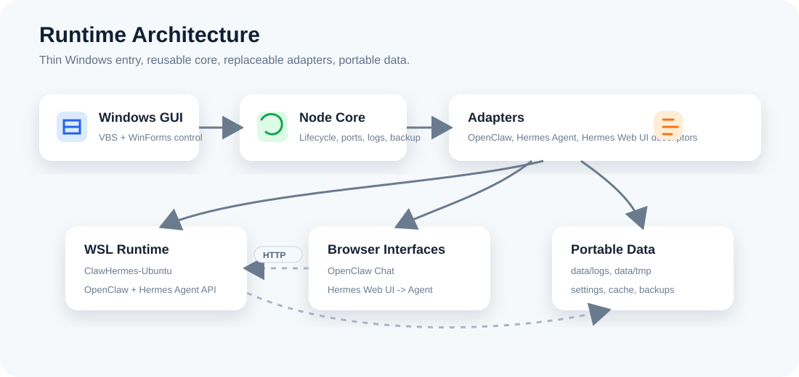

# ClawHermes-USB

ClawHermes-USB 是一个 **Windows 优先的便携运行套件**，用同一个项目目录在 U 盘上运行
[OpenClaw](https://github.com/openclaw/openclaw)、[Hermes Agent](https://github.com/NousResearch/hermes-agent)
和 [EKKOLearnAI/hermes-web-ui](https://github.com/EKKOLearnAI/hermes-web-ui)。



> ⚠️ **重要：本目录是「发行版（release）」，不是「开发仓库（source repo）」**
服务适配器、备份流程和本地门户，让用户能在不同 Windows 机器之间带走自己的 agent 环境，并尽量减少对宿主机的污染。

> 开发标注：本项目开发过程中使用了 [Superpowers](https://github.com/obra/superpowers)、
> OpenAI ChatGPT 5.5 模型和 OpenAI Codex 辅助完成。

---

## 一、当前状态

仓库现在包含可运行的 TypeScript + Node.js 编排骨架，以及面向 Windows 的小型 Batch / PowerShell 启动器。

### 已经实现

- **USB 根目录检测**：从启动器所在位置向上探测，支持 `CLAWHERMES_USB_ROOT` 环境变量与提示文件覆盖。
- **进程级便携环境变量**：不污染宿主机全局配置。
- **诊断体系**：运行时、路径、端口、适配器、env 文件、就绪状态。
- **只读安装向导**：按顺序编排诊断、运行时准备、env 文件、可选 WSL2 流程、payload 打包、适配器安装、验证、备份、发布。
- **适配器描述加载**与依赖排序。
- **服务启停**：带日志与 PID 元数据。
- **生产级适配器**的受管进程启动。
- **本地门户**：默认 `http://127.0.0.1:17000/`，含实时状态、安装动作、适配器验证、日志、备份状态、受保护的操作命令。
- **端口冲突自动重映射**：默认端口被占用时自动选空闲端口，写入 `data/tmp/ports.json`。
- **统一网关/鉴权 token**：OpenClaw、Hermes Agent、Hermes Web UI 默认均为 `clawhermes`。
- **便携备份**：时间戳 zip 归档写入 `data/backups/`。
- **只读恢复计划**与受保护的"不覆盖"恢复执行。
- **Hermes Agent 的 Windows 原生适配路径**：项目内 Python venv + `http://127.0.0.1:8642/health`。
- **OpenClaw 的 Windows 原生适配路径**：Node.js + pnpm + 项目内 state/log 路径 + `http://127.0.0.1:18789/healthz`。
- **本地控制服务**（`127.0.0.1`）：为桌面客户端提供状态、安装诊断、日志、模型配置、服务启停、关闭的 JSON API。
- **PyQt 控制面板**骨架位于 `launcher/pyqt/`，打开时启动或复用本地控制服务。
- **可选 WSL2 流程**：诊断、导入/导出、注销，保留给仍需要 WSL 的适配器或运维场景。
- **项目内 WSL 导出备份**：`data/backups/wsl/`。
- **只读 payload 清单**：被忽略的 app checkout、WSL rootfs 归档、WSL 备份。

### 尚未实现

- OpenClaw / Hermes Agent / Hermes Web UI 的自动下载、内置化（vendoring）或安装。
- 被忽略的上游 app payload 与可选 WSL rootfs 产物的**一键打包**。
- 受版本控制的最终 `ClawHermes-Control.exe` 二进制；打包发布时用 `launcher/pyqt/build.ps1` 现场构建。

---

## 二、快速开始

### 普通用户（U 盘使用者）

**推荐入口**：双击

```text
launcher/windows/ClawHermes-Control.vbs
```

它打开图形控制中心，**不显示黑色命令窗口**。



如果 VBS 被杀毒软件拦截，改用兼容入口：

```text
launcher/windows/ClawHermes-Control.bat
```

GUI 左侧导航包含：安装、启停服务、OpenClaw 聊天、Hermes Web UI、模型配置、日志、备份、修复/更新、明暗/跟随系统主题。
偏好保存在 `data\settings\gui.json`；状态/日志/配置命令异步执行，窗口不会卡住。

### 开发者

> **注意**：以下步骤需要**完整源码仓库**（含 `package.json` 与 `core/node/src/`）。
> 当前目录是发行版，执行会报 `npm error enoent`。

```powershell
npm install
npm run build
npm test
```

然后启动 GUI：

```powershell
launcher/windows/ClawHermes-Control.vbs
```

若你只有发行版目录，可先跑已经可用的复刻子系统测试：

```powershell
cd replica
npm test
```

更完整的本地运行说明见 [开发者本地运行指南](docs/developer-local-runbook.zh-CN.md)。

---

## 三、控制中心与启动器

### 图形控制中心（推荐）

PyQt 控制面板源码在 `launcher/pyqt/`。它在打开时启动本地控制服务，
通过 `/api/status`、`/api/services/*`、`/api/model-config`、`/api/logs` 通信。打包 EXE：

```powershell
launcher/pyqt/build.ps1
```

**模型配置**填写 API URL / Base URL、模型名、API Key，并选择应用到 OpenClaw、Hermes 或两者。
脱敏后的状态存于 `data/settings/model-config.json`，OpenClaw 配置写入 `data/openclaw/openclaw.json`，Hermes 配置写入 `data/hermes/`。

### 编号双击启动器（GUI 不可用时的后备）

日常使用：

```text
launcher/windows/1-Install-ClawHermes.bat
launcher/windows/2-Start-ClawHermes.bat
launcher/windows/3-Stop-ClawHermes.bat
launcher/windows/4-Status-ClawHermes.bat
launcher/windows/5-Backup-ClawHermes.bat
```

仅供高级维护：

```text
launcher/windows/6-Uninstall-Host-WSL-ClawHermes.bat
launcher/windows/Tools-Repair-Or-Update-ClawHermes.bat
```

> `6-Uninstall-Host-WSL-ClawHermes.bat` **不属于日常使用**。它会在备份并显式确认后，
> 从当前 Windows 宿主机移除受管 WSL 发行版。
> `Tools-Repair-Or-Update-ClawHermes.bat` 用于高级维护，可能需要网络访问。

正常发布路径是**离线优先**：把便携运行时和 app payload 准备好再交给用户。
只有在你确实要交付基于 WSL 的适配路径时，才准备 WSL 产物。

`Start.bat` 启动成功后打开本地门户。若 `17000` 被占用，核心会选一个空闲端口，
`Start.bat` 从 `data/tmp/ports.json` 读取实际地址打开。所有 Batch 启动器都会转发核心命令的退出码。

---

## 四、Node CLI 速查

```powershell
# 安装与诊断
node core/node/dist/clawhermes.js setup --json
node core/node/dist/clawhermes.js setup-wizard --json
node core/node/dist/clawhermes.js status --json

# 服务启停
node core/node/dist/clawhermes.js start --json
node core/node/dist/clawhermes.js stop --json
node core/node/dist/clawhermes.js control-server --port 0 --json
node core/node/dist/clawhermes.js control-server-stop --json

# 日志
node core/node/dist/clawhermes.js logs openclaw --lines 50 --json

# 模型配置
node core/node/dist/clawhermes.js model-config --provider-type openai-compatible --api-url https://api.example.com/v1 --model demo-model --api-key sk-example --apply both --json
node core/node/dist/clawhermes.js model-config-status --json

# 备份与恢复
node core/node/dist/clawhermes.js backup --dry-run --json
node core/node/dist/clawhermes.js restore-plan --archive data/backups/example.zip --json
node core/node/dist/clawhermes.js restore --archive data/backups/example.zip --confirm-restore --json

# 适配器
node core/node/dist/clawhermes.js adapters --json
node core/node/dist/clawhermes.js verify-adapter hermes-web-ui --json

# payload
node core/node/dist/clawhermes.js payloads --json
node core/node/dist/clawhermes.js payload-export --dry-run --json
```

**WSL2 说明**：默认适配器已不再需要 WSL2，但受保护的 WSL 流程仍可用。
`prepare-wsl` 默认只打印计划，真正修改宿主机需要 `--confirm-install`。
WSL2 适配器运行在 `ClawHermes-Ubuntu`；rootfs/导入导出计划以 `Ubuntu` 作为源发行版。
`wsl-import-plan` 的 rootfs 归档由运维放置在 `runtimes/wsl/`，详见 [WSL2 Rootfs 产物策略](docs/wsl-rootfs-artifacts.md)。

**本地鉴权说明**：默认便携 env 模板把 OpenClaw gateway token、Hermes Agent API server key、
Hermes Web UI auth token 都设为 `clawhermes`。**在受信 localhost 之外共享运行实例前，必须先改 `config/env/*.env`。**

---

## 五、U 盘交付

**不要让普通用户在 U 盘上执行 `npm install`、`pnpm install` 或 Python 依赖安装。**
交付前应在开发机或构建机上准备好：

- `apps/openclaw`、`apps/hermes-agent`、`apps/hermes-web-ui`（预构建产物，不是源码工作树）
- `runtimes/`（便携 Node、Python、Git）
- `core/node/dist`
- 可选的 WSL rootfs 或 WSL 备份 payload（仅交付 WSL 路径时需要）

U 盘速度会影响体验，尤其是 `node_modules`、Python venv、SQLite、日志和缓存。
建议 USB 3.x 高速 U 盘或移动 SSD，且**尽量交付预构建产物**。

完整说明：

- [U 盘部署与交付指南](docs/usb-deployment.zh-CN.md)
- [U 盘交付包生成 Runbook](docs/usb-release-build-runbook.zh-CN.md)

---

## 六、目录结构

```text
ClawHermes-USB/
  launcher/    面向用户的启动、停止、安装、状态、备份脚本与 GUI 入口
  core/        共享的 TypeScript/Node 编排逻辑与 Windows 分发器
  adapters/    各服务的集成描述符与辅助代码
  apps/        上游应用 checkout 或已安装包（不纳入版本控制）
  runtimes/    便携 Node.js、Python、Git 等运行时（不纳入版本控制）
  data/        便携状态、记忆、会话、日志、缓存、临时文件、备份（不纳入版本控制）
  portal/      本地统一入口页面
  config/      默认值、env 模板、配置档、端口
  scripts/     安装、诊断、备份、更新自动化
  docs/        产品与架构文档
  replica/     编排层复刻实现（独立子系统，见下方第七节）
  reconstruction/business/  逆向复刻的源码底本
```

---

## 七、编排层复刻子系统（replica/）

> 这是本仓库中一个**独立的逆向工程产物**，与主项目开发规则不同。

`replica/` 是对发布产物 `ClawHermes-Control-Electrobun-Setup.tar.zst` 中
**业务逻辑段的独立复刻实现**，通过静态逆向分析得出。

### 为什么值得单独说明

那个 8.6 MB 的 `bun/index.js` 里，真正需要复刻的业务逻辑**只有 12,906 字符**
（23 个函数 + 19 个 RPC handler），其余 890 万字符都是可直接依赖的开源框架 Electrobun。
这使复刻从"不可能"变成"可控"。

### 验收标准是等价性，不是代码质量

`replica/` 里**刻意保留**了原产物中看起来"反直觉"的行为：

- `saveModelConfig` 的 `providerType` 固定 `"openai-compatible"`、`apply` 固定 `"both"`，忽略入参
- `stopAllServices` 无论 API 成败**都**执行一次 CLI stop，返回 `apiResult ?? cliResult`
- `pingSync` 用独立 node 子进程 + 退出码，而不是直接 fetch
- RPC `maxRequestTime` 为 `Infinity`
- 日志文件只 append，无轮转
- 退出流程存在竞态，未加锁

**不要"优化"它们** —— 改动前请先查 `docs/reconstruction/OBLIGATIONS.md` 中对应编号。

### 验证状态

| 检查 | 结果 |
|---|---|
| 单元测试 | 82 个，本地与 CI 全绿 |
| 端到端验证 | 14 项真实控制服务对接，全部通过 |
| 义务覆盖 | 72/78 = 92.3%（其余 6 条均非复刻对象） |
| CI | Node 22 与 24 双版本通过 |

运行复刻测试：

```powershell
cd replica
npm test
```

### 逆全过程文档

| 文档 | 内容 |
|---|---|
| [执行计划](docs/reconstruction/REPLICA-PLAN.md) | 阶段 0–5 |
| [范围声明](docs/reconstruction/SCOPE.md) | 边界决策 |
| [产物勘察](docs/reconstruction/ARTIFACT-INVENTORY.md) | 成员清单与代码分层 |
| [义务清单](docs/reconstruction/OBLIGATIONS.md) | 78 条可测规格 |
| [覆盖率](docs/reconstruction/COVERAGE.md) | 三态自评 |
| [端到端验证](docs/reconstruction/E2E-VERIFICATION.md) | 真实对接记录 |
| [发布记录](docs/reconstruction/RELEASE-DECISION.md) | 仓库与发布决策 |

---

## 八、目录现状（重要）

> 当前 `F:\DTC` 是**从 U 盘拷贝的发行版**，不是完整开发仓库。

### 有

| 目录 / 文件 | 说明 |
|---|---|
| `core/node/dist/` | 34 个已编译 JS，可直接 `node` 运行（源码不在本目录） |
| `apps/` | openclaw / hermes-agent / hermes-web-ui 三个上游 checkout |
| `skills/` | 90 个技能包 |
| `config/` `adapters/` `portal/` `docs/` | 配置、适配器契约、门户、全套文档 |
| `replica/` | 编排层复刻实现（82 个测试通过） |

### 没有

| 缺失项 | 影响 |
|---|---|
| `package.json` `tsconfig.json` | 无法 `npm install` / `npm run build` / `npm test` |
| `core/node/src/` | 无法修改核心逻辑，只能改 `dist/*.js` |
| `launcher/` | README 引用但实际不存在（VBS / BAT / PyQt 入口） |
| `scripts/` | 自动化脚本目录不存在 |

### 三条应对路线

详见 [docs/RECOVERY-PLAN.md](docs/RECOVERY-PLAN.md)：

- **路线 A**：反向还原 `dist` 为源码工程
- **路线 B**：以 `replica/` 为基础向上长成完整产品
- **路线 C**：只修文档，承认是发行版

> **如果你手上有原始开发仓库（含 `src/` 与 `package.json`），优先用真源码，不要还原。**

---

## 九、核心文档

| 中文 | 英文 |
|---|---|
| [PRD](docs/PRD.zh-CN.md) | [PRD](docs/PRD.md) |
| [架构设计](docs/DESIGN.zh-CN.md) | [Design](docs/DESIGN.md) |
| [适配器契约](docs/ADAPTER_CONTRACT.zh-CN.md) | [Adapter Contract](docs/ADAPTER_CONTRACT.md) |
| — | [Progress Log](docs/PROGRESS.md) |
| — | [Release Checklist](docs/release-checklist.md) |
| [开发者本地运行指南](docs/developer-local-runbook.zh-CN.md) | — |
| [U 盘部署指南](docs/usb-deployment.zh-CN.md) | — |
| [U 盘交付包生成 Runbook](docs/usb-release-build-runbook.zh-CN.md) | — |
| [发布检查清单](docs/release-checklist.zh-CN.md) | [Release Checklist](docs/release-checklist.md) |
| [上游集成说明](docs/upstream-integration.zh-CN.md) | [Upstream Integration](docs/upstream-integration.md) |
| [WSL2 Rootfs 产物策略](docs/wsl-rootfs-artifacts.zh-CN.md) | [WSL Rootfs Artifacts](docs/wsl-rootfs-artifacts.md) |
| [**续建计划**](docs/RECOVERY-PLAN.md) | — |
| [Electrobun 控制壳](docs/electrobun-control-shell.zh-CN.md) | — |
| [便携数据](docs/portable-data.zh-CN.md) | [Portable Data](docs/portable-data.md) |
| [Windows 运行时](docs/windows-runtime.zh-CN.md) | [Windows Runtime](docs/windows-runtime.md) |
| [macOS 路线图](docs/macos-roadmap.zh-CN.md) | [macOS Roadmap](docs/macos-roadmap.md) |

---

## 十、设计目标



- **Windows 优先**的便携运行。
- 把 OpenClaw、Hermes Agent、Hermes Web UI、运行时依赖、会话、记忆、技能、日志、工作区数据**全部放在 U 盘上**。
- 允许少量不可避免的宿主机痕迹（浏览器缓存、OS 最近文件记录等）。
- **主路径不依赖 Docker**。
- 保持清晰边界，使后续贡献者可以替换或扩展服务，而不用重写启动器。

---

## 十一、其他

- 贡献方式见 [CONTRIBUTING.md](CONTRIBUTING.md)
- 第三方组件与许可证见 [THIRD_PARTY_NOTICES.md](THIRD_PARTY_NOTICES.md)
- 项目许可证：[Apache-2.0](LICENSE)
- 中文文档必须保持 **UTF-8 可读**，不能提交乱码（`.gitattributes` 已做保障）。

当前本地验证使用：OpenClaw `82c4fd8f56751faa03470e32f4763b7245c69b71`，
Hermes Agent `f27fcb6a82b8487174ca941c15e7a5887371eede`。
大型上游 checkout、依赖目录、可选 WSL rootfs 归档与 WSL 备份均为本地忽略的 payload，不纳入源码。
